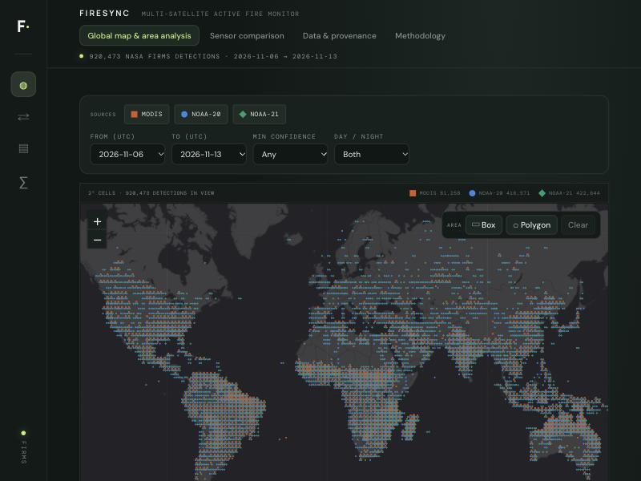

# FireSync

**Global multi-satellite active-fire monitoring and sensor comparison.** Team *We Are Aliens*, NASA Space Apps Challenge Cairo 2026.

FireSync maps about 920,000 real NASA FIRMS active-fire detections from three satellite sources:

- MODIS (Terra + Aqua)
- VIIRS NOAA-20
- VIIRS NOAA-21

It analyzes any area you draw and compares the satellites with a paired spatio-temporal method.

The sources stay separate throughout. Nothing is averaged or merged across sensors, and every
number on screen comes from the data. See [docs/METHODOLOGY.md](docs/METHODOLOGY.md) for the
science, [DATA_PROVENANCE.md](DATA_PROVENANCE.md) for where every file came from, and
[docs/DEMO_GUIDE.md](docs/DEMO_GUIDE.md) for a 5-minute walkthrough.



## Features

| View | What it does |
|---|---|
| **Global map & area analysis** | Canvas-rendered map. Detections are aggregated server-side into 2° → 0.1° cells as you zoom, and become individual detections at zoom ≥ 7. Each source has its own color and shape (MODIS ■, NOAA-20 ●, NOAA-21 ◆). Click a cell for per-source counts, or a detection for its full source record. Filter by source, UTC date, confidence class and day/night. Draw a **box** or **polygon**, or type coordinates, to get per-satellite totals, daily and hourly activity, FRP distribution and statistics, confidence classes, top active cells (click to fly there), and a **CSV export** of the exact source rows. |
| **Sensor comparison** | Paired cell-overpass matching on a common grid with a time window. It reports co-detection rates and separates "not detected" from "not in view" using NASA **swath footprints**: one granule outline per 5–6 minutes per satellite, from the public CMR catalogue. Catalogue gaps are reported as unknown. It also shows the distribution of overpass time offsets, a paired FRP scatter, an overpass-order test, and a calibration that is validated on held-out dates against 1:1. Calibration is refused when the sensors don't observe simultaneously. Presets cover NOAA-20 ↔ NOAA-21 and Aqua MODIS ↔ VIIRS. Runs globally or inside the drawn area. |
| **Data & provenance** | Per-dataset row counts, a daily strip, SHA-256, quality checks, and an exact-row cross-check against direct FIRMS API retrievals. The original FireSync local-file / API-import map is kept here unchanged. |
| **Methodology** | Summary of the method and its limits. |

## Quick start

Requirements: Python 3.9+ and Node.js 20.19+ or 22.12+.

**1. Backend** (from the project root):

```sh
python3 -m venv backend/.venv
backend/.venv/bin/python -m pip install -r backend/requirements.txt
```

```sh
backend/.venv/bin/uvicorn app.main:app --app-dir backend --env-file backend/.env --host 127.0.0.1 --port 8000
```

**2. Global datasets.** This is already done in this workspace, and only needs repeating on a
new machine. Download the three FIRMS global 7-day CSVs, then register them:

```sh
backend/.venv/bin/python backend/scripts/register_global.py --modis ~/Downloads/MODIS_C6_1_Global_7d.csv --noaa20 ~/Downloads/J1_VIIRS_C2_Global_7d.csv --noaa21 ~/Downloads/J2_VIIRS_C2_Global_7d.csv
```

Swath footprints are already committed under `data/global/*/swaths.json`. To fetch them for
newly registered data (public NASA CMR, no key needed):

```sh
backend/.venv/bin/python backend/scripts/fetch_swaths.py
```

The large CSVs under `data/global/*/observations.csv` are git-ignored. Their `metadata.json`
sidecars (with SHA-256) are committed, so a re-download can be verified.

**3. Frontend** (second terminal):

```sh
cd frontend && npm install && npm run dev -- --host 127.0.0.1 --port 5173
```

Open <http://127.0.0.1:5173>. The first request after the API starts loads about 75 MB of
CSV into memory in about 1 second.

### NASA FIRMS MAP_KEY

`FIRMS_MAP_KEY` lives only in `backend/.env`, which is git-ignored. It is never sent to the
frontend, logged, or returned by any endpoint. It is only needed for new FIRMS API imports
(`POST /api/firms/import`), not for the global datasets above. Request a key from the
[NASA FIRMS API page](https://firms.modaps.eosdis.nasa.gov/api/).

## API

Global datasets (all GET):

| Endpoint | Purpose |
|---|---|
| `/api/global/datasets` | Provenance and profile of each registered dataset (no filesystem paths). |
| `/api/global/grid?cell=…` | Detections per grid cell, per source. `cell` must be one of 0.05, 0.1, 0.25, 0.5, 1 or 2. |
| `/api/global/points?south&west&north&east&limit` | Individual detections in a box. Capped at `limit` (max 25,000) with an explicit `truncated` flag; the highest-FRP detections are kept. |
| `/api/global/record/{source}/{row}` | One source row, unchanged. |
| `/api/global/stats` | Area analysis: totals, daily, hourly, FRP quantiles and histogram, confidence, day/night, satellites, top cells. |
| `/api/global/compare?a&b&window&cell&satellite_a` | Paired sensor comparison and calibration (see the methodology). |
| `/api/global/export.csv` | Streams the matching source rows unchanged, plus `dataset`, `firms_source`, `source_sha256` and `source_row`. |

Common filters: repeated `source` (`modis`, `noaa20`, `noaa21`), `date_from`, `date_to`,
`min_confidence` (`low`/`nominal`/`high`), `daynight` (`D`/`N`), a bounding box
(`south`, `west`, `north`, `east`; no dateline crossing), or `polygon=lat,lon;lat,lon;…`
(3–200 vertices). Inputs are validated and return 422 on error. Responses are gzip-compressed.

The original foundation endpoints are unchanged:

- `/api/health`
- `/api/datasets/summary`
- `/api/observations`
- `/api/observations/filters`
- `/api/firms/status`
- `/api/firms/imports`
- `POST /api/firms/import`
- `/api/firms/imports/{id}/observations`

Interactive docs are at <http://127.0.0.1:8000/docs>.

## Tests

```sh
backend/.venv/bin/python -m pytest -q backend
```

```sh
cd frontend && npm run build
```

Current result: **53 passed, 1 skipped**. The skip is a pre-existing test, and the suite also
passes with `-W error::RuntimeWarning`. The production build passes. Tests include synthetic
datasets with known answers for:

- Grid conservation and point truncation.
- Polygon, box, confidence and day/night filters.
- Pairing and the coverage proxy.
- Recovery of a known calibration, and refusal for non-simultaneous pairs.
- Common-date restriction.
- Exact-value export, integrity failure, and path safety.

A further test checks the real registered datasets against their sidecars.

Reproduce the published comparison numbers:

```sh
backend/.venv/bin/python backend/scripts/run_comparison.py
```

## Project layout

```
backend/app/main.py            FastAPI app (foundation + /api/global/*)
backend/app/global_data.py     columnar dataset store, filters, grid, stats, export
backend/app/compare.py         paired cell-overpass comparison and calibration
backend/app/firms.py           FIRMS API client and immutable import storage
backend/scripts/               register_global.py, fetch_swaths.py, run_comparison.py
backend/app/swaths.py          swath footprints: spherical containment, catalogue-gap handling
frontend/src/GlobalMap.tsx     canvas map, area drawing, record inspector
frontend/src/DetectionLayer.ts custom Leaflet canvas layer (no DOM markers)
frontend/src/AnalyticsPanel.tsx, ComparePanel.tsx, DataPanel.tsx, charts.tsx
frontend/src/WildfireMap.tsx   original foundation map (unchanged)
data/global/                   registered datasets, swath footprints + provenance sidecars
data/imports/                  FIRMS API imports + sidecars
docs/                          methodology, demo guide, comparison results, screenshots
```

## Limitations

- **Data window.** Eight UTC days of NRT data (6–13 Nov 2026, last day partial). No
  multi-year archive is loaded, so there is no historical calendar or anomaly baseline, and
  none is simulated.
- **Detections, not fires.** Counts are detections. "No detection" is not "no fire".
- **MODIS ↔ VIIRS calibration.** It isn't supported by this data: the sensors are 2+ hours
  apart.
- **Map and area geometry.** Boxes and polygons do not cross the antimeridian. The basemap is
  Esri World Dark Gray, which needs internet access.
